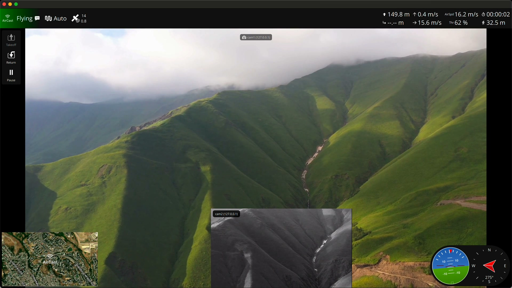
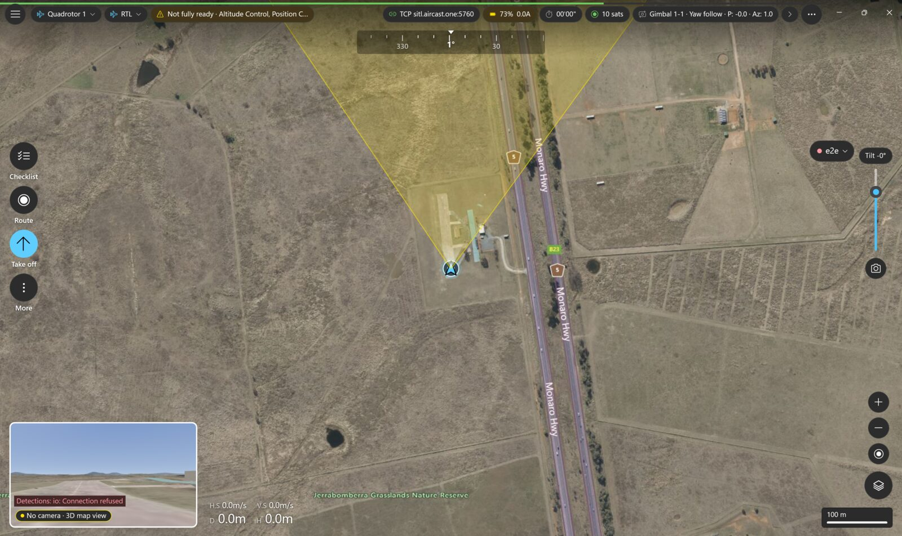
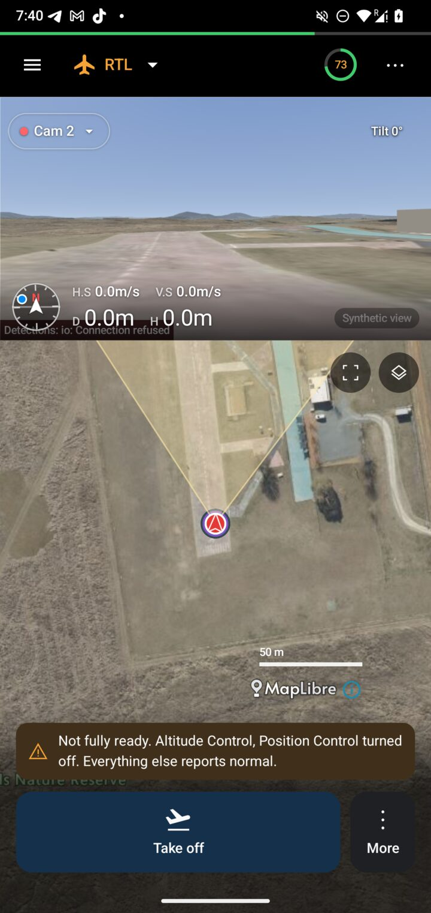
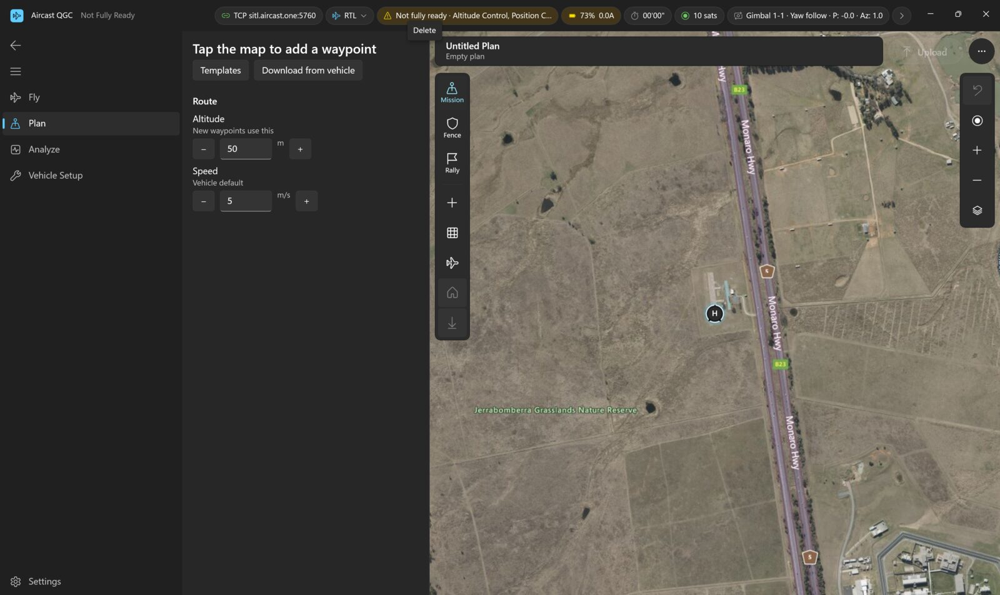
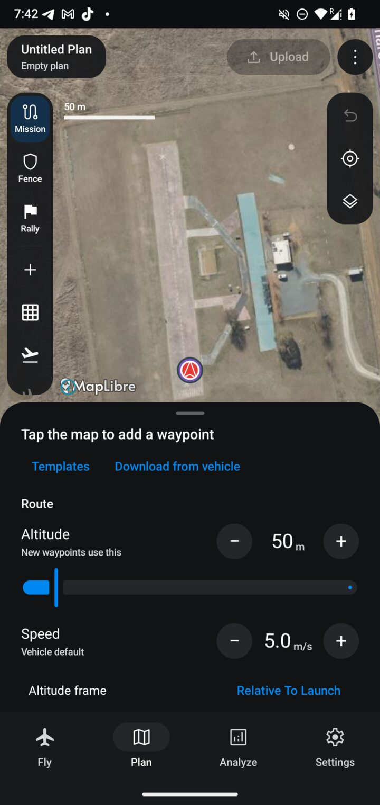

# Aircast QGC

  

**Aircast QGC** is [Aircast](https://aircast.one)'s fork of [QGroundControl](https://github.com/mavlink/qgroundcontrol), tailored for operating drones over cellular links with a video-first ground station. It tracks upstream QGC and adds the features Aircast needs for low-latency cellular video and fleet operations.

---

## What Aircast adds

  

- **Multiple cameras** — configure any number of video cameras in a unified camera list, mixing RTSP, WHEP/WebRTC, UDP, and TCP sources. Switch the active camera from an in-view button, or view several at once.
- **Multi-camera video UX** — draggable, resizable, collapsible picture-in-picture and per-camera video tiles; drag the instrument and telemetry panels anywhere. Layout persists across restarts.
- **Zero-restart camera switching** — switching the active camera keeps every stream playing, with no RTSP/WHEP renegotiation and no black-frame wait.
- **WHEP / WebRTC video** — low-latency WebRTC (WHEP) video source alongside the standard RTSP/UDP/TCP inputs, for cellular streaming.
- **Per-camera connection status** — live status plus decoded-frame and bitrate counters, on tiles and in camera settings.
- **Android hardware video decode** — MediaCodec hardware-accelerated decoding on Android for smoother, lower-CPU video.
- **One-tap device setup** — open `aircast-qgc://setup?host=<device>` and the app configures itself from an aircastd device: every camera (primary RTSP + extra WHEP sources) and a connected MAVLink telemetry link.
- **Debug API + MCP automation** *(opt-in, localhost only)* — a header-authenticated 127.0.0.1 API and a Model Context Protocol server for driving the app from tests, CI, and tooling. Off by default; no flight commands exposed.

See the [release notes](https://github.com/aircast-one/qgroundcontrol/releases) for what shipped in each version.

## Beta apps: native Android and Windows

The 5.6 line, published as pre-releases tagged `aircast-v5.6.*`, adds two native ground stations on the shared Rust flight core: **Aircast Android** (Kotlin + Compose) and **Aircast QGC for Windows** (WinUI 3). Both talk to the same vehicle the same way; the screenshots below were taken at the same moment against one ArduCopter 4.7.2 SITL. Stable installers stay on the 5.5 line.

  
  

  
  

| Platform | Asset on the newest [pre-release](https://github.com/aircast-one/qgroundcontrol/releases) | Notes |
| --- | --- | --- |
| Android 9 or newer | `AircastAndroid-<version>.apk` | Sideload; arm64 and armv7 in one APK |
| Windows 10/11 x64 | `AircastQGCNative-<version>-windows-x64-setup.exe` | Per-user install, no admin rights |
| Windows 11 ARM64 | `AircastQGCNative-<version>-windows-arm64-setup.exe` | Snapdragon and other ARM laptops |

No drone yet? Fly → **Add a link** → **Simulated vehicle** runs the whole app against a built-in vehicle.

## Download

Installers for macOS, Windows, Linux, and Android are on the [**Releases**](https://github.com/aircast-one/qgroundcontrol/releases/latest) page. Every asset ships with a `.sha256` checksum.

## Build

Build instructions match upstream QGroundControl — see the [Developer Guide](https://dev.qgroundcontrol.com/en/) and [build instructions](https://dev.qgroundcontrol.com/en/getting_started/). Releases are cut with `make release.<patch|minor|major>`, which tags `aircast-v*` and triggers the release workflow.

---

## About QGroundControl

Aircast QGC is built on *QGroundControl* (QGC), a powerful Ground Control Station for UAVs, providing full flight control and mission planning for any *MAVLink-enabled drone* running *PX4* or *ArduPilot*.

- [Official Website](http://qgroundcontrol.com)
- [User Manual](https://docs.qgroundcontrol.com/en/)
- [Developer Guide](https://dev.qgroundcontrol.com/en/)
- [Contributing to upstream](https://dev.qgroundcontrol.com/en/contribute/)
- [License](https://github.com/mavlink/qgroundcontrol/blob/master/.github/COPYING.md)

QGroundControl is open-source under a dual Apache 2.0 / GPLv3 license. Aircast QGC inherits that license; upstream contributions are welcome at [mavlink/QGroundControl](https://github.com/mavlink/qgroundcontrol).
